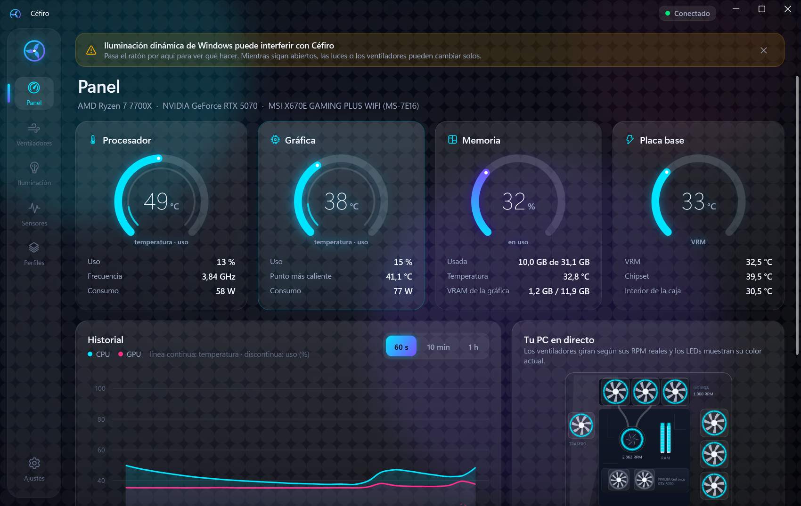
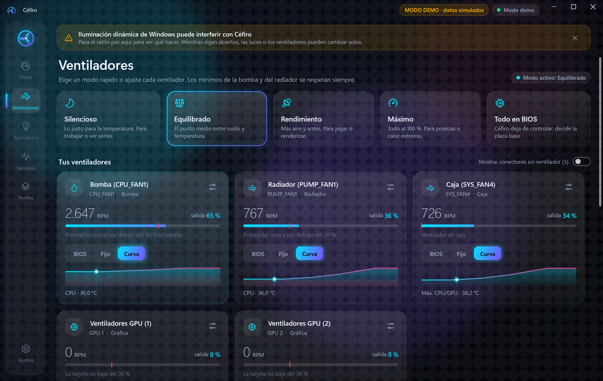
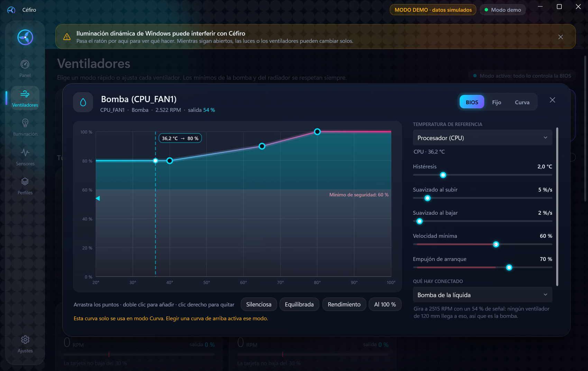
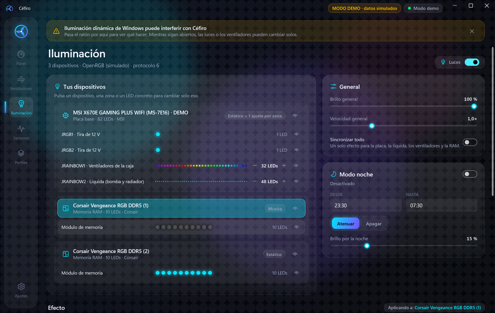

<p align="center">
  
</p>

<h1 align="center">Céfiro</h1>

<p align="center"><b>Ventiladores e iluminación RGB para tu PC, con seguridad para tu líquida.</b><br/>
Windows 11 · .NET 10 · LibreHardwareMonitor + PawnIO · OpenRGB 1.x</p>

---

Céfiro controla los ventiladores (placa y gráfica) y las luces RGB (placa, ventiladores ARGB, líquida y RAM)
desde una sola aplicación. Un **servicio de Windows** hace el trabajo con el hardware aunque cierres la ventana,
y la **interfaz** solo muestra y cambia ajustes: no necesita permisos de administrador ni muestra avisos de UAC.

## Qué hace

| | |
|---|---|
| **Panel** | Temperatura, uso, frecuencia y consumo de CPU y GPU, RAM, VRM y chipset, RPM de cada ventilador y de la bomba. Medidores animados, historial de 60 s / 10 min / 1 h y un esquema de tu caja con los ventiladores girando a su velocidad real y los LEDs con su color actual. |
| **Ventiladores** | Modos rápidos (Silencioso, Equilibrado, Rendimiento, Máximo, todo en BIOS). Por cada salida: nombre, modo BIOS / fijo / curva, editor de curva con puntos arrastrables y la temperatura en directo, temperatura de referencia (CPU, GPU, VRM, caja, la más alta o la media), histéresis, suavizado de subida y bajada, mínimo, empujón de arranque, parada a 0 RPM (solo caja), grupos y calibración automática. |
| **Iluminación** | Vista previa en directo de cada zona y LED. Estático, respiración, arcoíris, ola, ciclo de color, cometa, temperatura, música (sonido del PC) y los modos propios de cada dispositivo. Por dispositivo, zona o LED; rueda de color, HEX y favoritos; brillo y velocidad generales; sincronizar todo con un clic; modo noche (apagar o atenuar por horario). |
| **Perfiles** | Ventiladores y luces guardados juntos. Se activan desde la app, desde el icono de la bandeja, con un atajo de teclado global o al abrir un programa (y al cerrarlo vuelve lo que tenías). Importar y exportar en JSON. |
| **Avisos** | Notificaciones de Windows si la CPU o la GPU se calientan demasiado, si un ventilador o la bomba se paran, si se pierde un sensor o si salta el modo de emergencia. |
| **Ajustes** | Color de acento (o que siga a las luces del PC), °C / °F, inicio con Windows, bandeja, cómo está montado tu PC, programas que interfieren, estado del servicio y registros. |

### Capturas

| Panel (tu PC) | Ventiladores |
|---|---|
|  |  |
| **Editor de curva** | **Iluminación por zona** |
|  |  |

## Seguridad del hardware

Estas reglas están en el servicio y **ningún ajuste, perfil importado o error de la interfaz puede saltárselas**:

- **Bomba**: nunca por debajo del **60 %** y nunca parada. Si una salida gira como una bomba (más de 2300 RPM con poca señal), se protege como bomba aunque se diga otra cosa.
- **Radiador**: nunca por debajo del **30 %**. **Gráfica**: nunca por debajo del mínimo de la tarjeta (30 % en tu RTX 5070).
- **Modo de emergencia**: si la CPU llega a **90 °C** o la GPU a **85 °C** (configurable), todos los ventiladores al 100 % hasta que bajen 8 °C durante 15 s.
- **Sensores**: si deja de leerse la temperatura de la CPU durante 3 s (configurable), **todos** los ventiladores vuelven a la BIOS;
  si falla solo la temperatura que sigue un ventilador, ese ventilador vuelve a la BIOS.
- **Si Céfiro se cierra, se detiene o falla, los ventiladores vuelven a la BIOS.** Windows reinicia el servicio solo si falla (a los 5 s, 15 s y 60 s).
- Todo valor se valida antes de enviarlo al hardware (rangos, roles, mínimos, curvas monótonas).

Por eso la **curva de la BIOS tiene que ser segura por sí sola** (ver «Ajustes de la BIOS»).

## Compatibilidad con tu PC

Comprobada en tu equipo (detalles y pruebas en [`docs/COMPATIBILIDAD.md`](docs/COMPATIBILIDAD.md)):

| Componente | Leer | Ventiladores | RGB |
|---|---|---|---|
| Ryzen 7 7700X | ✅ temperatura, uso, frecuencia, consumo | — | — |
| RTX 5070 | ✅ temperatura, hot spot, uso, consumo, RPM | ✅ (mínimo 30 %; 0 RPM solo en modo automático) | ❌ OpenRGB no ve su iluminación |
| MSI X670E Gaming Plus WiFi (NCT6687D) | ✅ CPU, sistema, VRM, chipset, voltajes | ✅ los 8 conectores | ✅ JRGB1/2 y JRAINBOW1/2 |
| Nautilus 360 RS (bomba en CPU_FAN1, radiador en PUMP_FAN1) | ✅ RPM | ✅ con los mínimos de arriba | ✅ por JRAINBOW2 |
| RS120 ARGB de la caja (todos en SYS_FAN4) | ✅ RPM | ✅ todos a la vez (comparten conector) | ✅ por JRAINBOW1 (8 LEDs, en paralelo) |
| Vengeance RGB DDR5 ×2 | ✅ temperatura | — | ✅ 10 LEDs por módulo |

Limitaciones por cómo está cableado: los ventiladores que comparten conector o cadena ARGB no se pueden
controlar por separado (todos giran igual y repiten los mismos 8 LEDs).

## Requisitos

1. **Windows 11 x64** (o Windows 10 22H2).
2. **PawnIO** (driver firmado que usa LibreHardwareMonitor para hablar con la placa): <https://pawnio.eu>. Sin él no hay lecturas ni control de los ventiladores de la placa.
3. **OpenRGB 1.x** con el **servidor SDK** activo en el puerto **6742** y arrancando con Windows: <https://openrgb.org>.
   En tu PC ya está instalado como servicio («OpenRGB»). Si lo instalas de nuevo: en OpenRGB, pestaña *Settings*, marca
   *Start at login*, *Start minimized* y *Start server*. Céfiro se reconecta solo si OpenRGB se reinicia.
4. **Nada más mandando sobre las luces o los ventiladores**: cierra o desinstala iCUE, el módulo **Mystic Light de MSI Center**,
   Armoury Crate, SignalRGB o L-Connect, y apaga la **iluminación dinámica de Windows**
   (*Configuración › Personalización › Iluminación dinámica*). Céfiro te avisa si detecta alguno.

No hace falta instalar .NET: el instalador lleva todo lo necesario.

## Ajustes de la BIOS (MSI Click BIOS 5)

En *Hardware Monitor* (pulsa **F7** para el modo avanzado):

- **Modo de los conectores**: pon **PWM** en CPU_FAN1, PUMP_FAN1 y SYS_FAN4 (los RS120 y la bomba son de 4 pines).
  «Auto» también sirve si la BIOS detecta bien el tipo.
- **Curvas de la BIOS seguras**, porque son las que mandan cuando Céfiro está en modo BIOS o no está en marcha:
  - **CPU_FAN1 (la bomba en tu PC)**: que nunca baje del **60 %**; lo más seguro es dejarla al **100 %** fijo (desactiva *Smart Fan Mode* en ese conector).
    Lo ideal sería conectar la bomba a **PUMP_FAN1** (va al 100 % por defecto) y los ventiladores del radiador a CPU_FAN1;
    Céfiro detecta el cambio solo.
  - **PUMP_FAN1 (el radiador)** y **SYS_FAN4 (la caja)**: una curva normal por temperatura de la CPU.
- **CPU Fan Fail Warning Control**: **Enabled** (avisa al arrancar si la bomba no gira).

## Instalación

1. Ejecuta **`Cefiro-Setup-1.0.0.exe`**. Como no está firmado, Windows SmartScreen puede avisar:
   *Más información › Ejecutar de todas formas*.
2. La primera página comprueba PawnIO, OpenRGB y los programas que pueden interferir.
3. Se instala en `C:\Program Files\Cefiro`:
   - el **servicio «Céfiro»** (inicio automático, cuenta de sistema, se reinicia solo si falla);
   - la **aplicación** (menú Inicio) y, si lo eliges, su **inicio en la bandeja al iniciar sesión** (sin UAC);
   - `cefiro-cli.exe` para diagnóstico.
4. Al terminar se abre Céfiro. Los ventiladores empiezan en **modo BIOS**: no cambia nada hasta que elijas un modo.

Instalación desatendida: `Cefiro-Setup-1.0.0.exe /SILENT` (sin abrir la app al terminar).

**Desinstalar**: *Configuración › Aplicaciones › Céfiro*. El servicio se detiene (los ventiladores vuelven a la BIOS)
y se borra; tu configuración se queda en `%ProgramData%\Cefiro` por si vuelves a instalarlo.

## Primeros pasos

1. **Panel**: comprueba que las temperaturas y las RPM coinciden con lo que esperas.
2. **Ventiladores**: pulsa **Equilibrado**. Si quieres afinar, abre los ajustes de un ventilador (icono de la derecha) y arrastra los puntos de la curva.
   Para la caja puedes pasar la **calibración automática** y luego *Aplicar mínimos calibrados*.
3. **Iluminación**: elige un efecto y un color. Para dar a la RAM o a la líquida algo distinto, desactiva *Sincronizar todo* y pulsa el dispositivo, la zona o un LED concreto.
4. **Perfiles**: con todo a tu gusto, *Nuevo perfil con lo actual*. Ponle un atajo (p. ej. Ctrl+Alt+1) o asócialo a un juego (`juego.exe`).

El efecto **Música** y los **atajos de teclado** necesitan que la app esté abierta (vale con que esté en la bandeja):
el servicio corre en otra sesión de Windows y no puede oír el sonido ni el teclado del usuario.

## Archivos

| Qué | Dónde |
|---|---|
| Configuración del hardware (ventiladores, luces, perfiles, calibración) | `%ProgramData%\Cefiro\config\` |
| Registros del servicio | `%ProgramData%\Cefiro\logs\servicio-AAAAMMDD.log` |
| Preferencias y registros de la interfaz | `%APPDATA%\Cefiro\` |

## Herramienta de consola

`cefiro-cli.exe` (en la carpeta de instalación) habla con el servicio: `status`, `catalog`, `monitor`, `history`,
`fans`, `watch-fans`, `fan`, `preset`, `calibrate`, `safety`, `lights`, `light`, `zone`, `identify`, `pattern`,
`music`, `audio-selftest` y `all-bios` (devuelve todos los ventiladores a la BIOS al momento).

## Rendimiento medido en tu PC

| | CPU (del total) | Memoria |
|---|---|---|
| Servicio, en reposo | 0,12–0,17 % | ~118 MB |
| Servicio con arcoíris a 30 fps | 0,18 % | |
| App en la bandeja | 0,04 % | ~146 MB |
| App con la ventana abierta en el Panel (animado) | ~0,9 % | ~188 MB |
| OpenRGB con un efecto fijo | ~0 % | ~31 MB |

## Compilar desde el código

Requisitos: **SDK de .NET 10** (10.0.404 o posterior) en Windows. Para el instalador, **Inno Setup 6**.

```powershell
dotnet build Cefiro.slnx
dotnet test --solution Cefiro.slnx
```

- **Modo demo** (hardware simulado, no toca nada): `src\Cefiro.App\bin\Debug\net10.0-windows10.0.19041.0\Cefiro.exe --demo`
- **Capturas del diseño**: `Cefiro.exe --demo --capture <carpeta>` guarda una imagen de cada página y sale.
- **Servicio en consola** (para el hardware real, como administrador): `Cefiro.Service.exe --console`; en demo: `--demo --console`.
- **Publicar e instalador**: `powershell -ExecutionPolicy Bypass -File build\publicar.ps1`
  (deja la app autocontenida en `artifacts\publish\Cefiro` y el instalador en `artifacts\instalador`).

### Proyectos

| Proyecto | Qué es |
|---|---|
| `Cefiro.Core` | Núcleo: bucle de hardware, curvas, histéresis, seguridad, emergencia, calibración, efectos, perfiles. Sin dependencias de hardware. |
| `Cefiro.Hardware` | LibreHardwareMonitor (sensores y ventiladores) y el puente con OpenRGB. |
| `Cefiro.OpenRgb` | Cliente propio del protocolo del SDK de OpenRGB (versión 6). |
| `Cefiro.Ipc` | Contratos y named pipe `\\.\pipe\cefiro` entre la interfaz y el servicio. |
| `Cefiro.Service` | Servicio de Windows (registros con Serilog). |
| `Cefiro.App` | Interfaz WPF (WPF-UI, LiveCharts2, H.NotifyIcon, CommunityToolkit.Mvvm). |
| `Cefiro.Audio` | Captura del sonido del PC (WASAPI loopback) y espectro para el efecto Música. |
| `Cefiro.Demo` | Hardware simulado con la forma de tu PC. |
| `tools/` | `cefiro-cli`, `Cefiro.HwProbe` (diagnóstico del hardware) y `Cefiro.IconGen` (genera el icono). |
| `tests/` | Pruebas: curvas, histéresis, emergencia, IPC, OpenRGB, iluminación, audio y perfiles. |

## Problemas frecuentes

- **«Conectando con el servicio…» todo el rato**: comprueba en `services.msc` que «Céfiro» está *En ejecución*; si no arranca, mira su registro.
- **No salen los ventiladores de la placa**: falta PawnIO o el servicio no tiene permisos (Ajustes › Servicio y hardware lo indica).
- **«OpenRGB no responde»**: OpenRGB no está abierto o no tiene el servidor SDK activo en el puerto 6742.
- **Las luces cambian solas**: hay otro programa mandando (Ajustes › Programas que pueden interferir).
- **Los ventiladores de una cadena tienen LEDs de más o de menos**: en Iluminación, ajusta con − / + los LEDs de JRAINBOW1/2 (8 por ventilador si van en paralelo).

## Créditos

[LibreHardwareMonitor](https://github.com/LibreHardwareMonitor/LibreHardwareMonitor) (MPL 2.0),
[PawnIO](https://pawnio.eu), [OpenRGB](https://openrgb.org) (se usa su servidor SDK; no se incluye),
[WPF-UI](https://github.com/lepoco/wpfui), [LiveCharts2](https://github.com/beto-rodriguez/LiveCharts2),
[CommunityToolkit.Mvvm](https://github.com/CommunityToolkit/dotnet), [H.NotifyIcon](https://github.com/HavenDV/H.NotifyIcon),
[NAudio](https://github.com/naudio/NAudio) (MIT) y [Serilog](https://serilog.net) (Apache 2.0).
